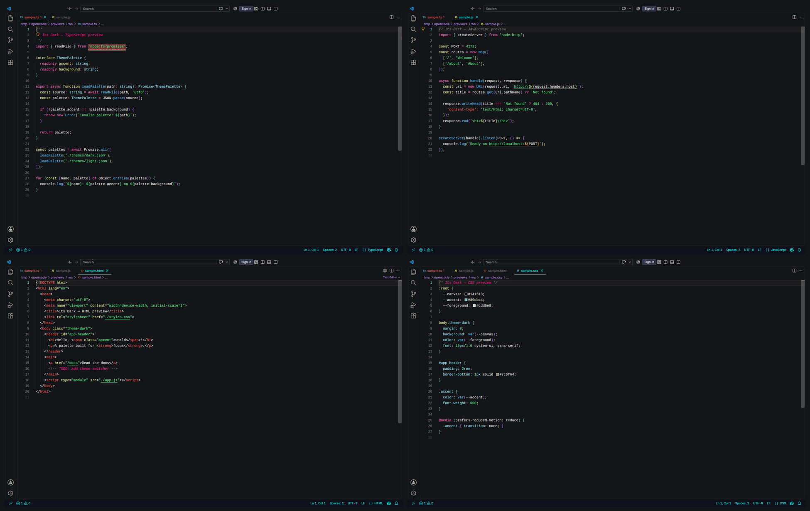
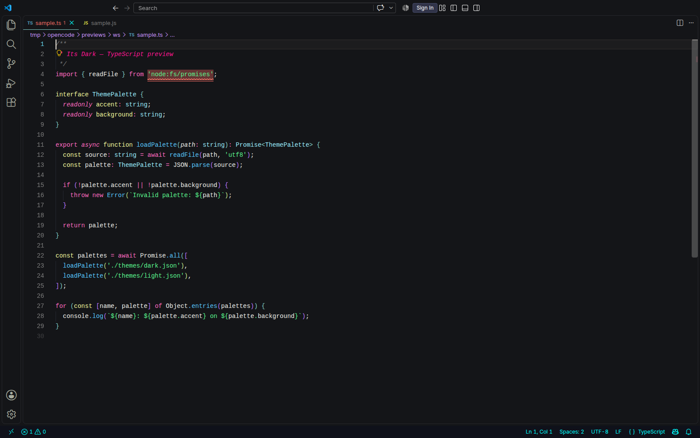
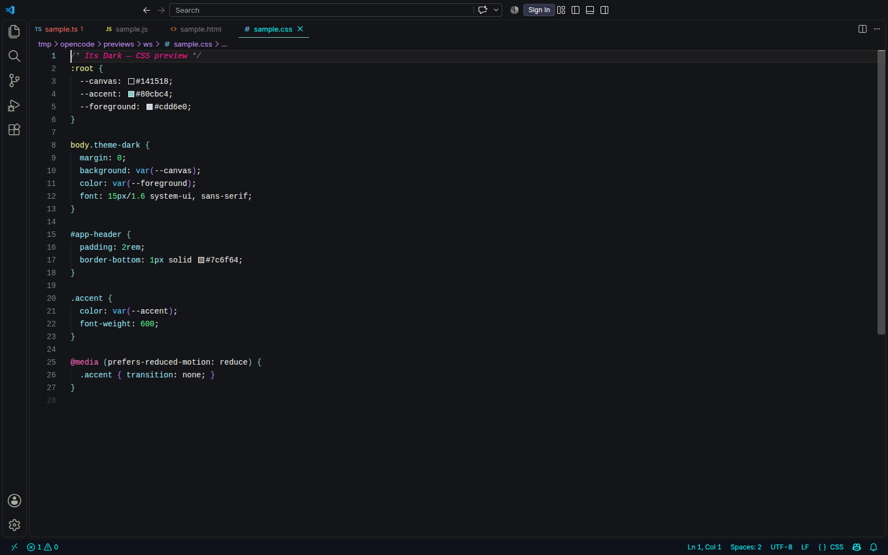
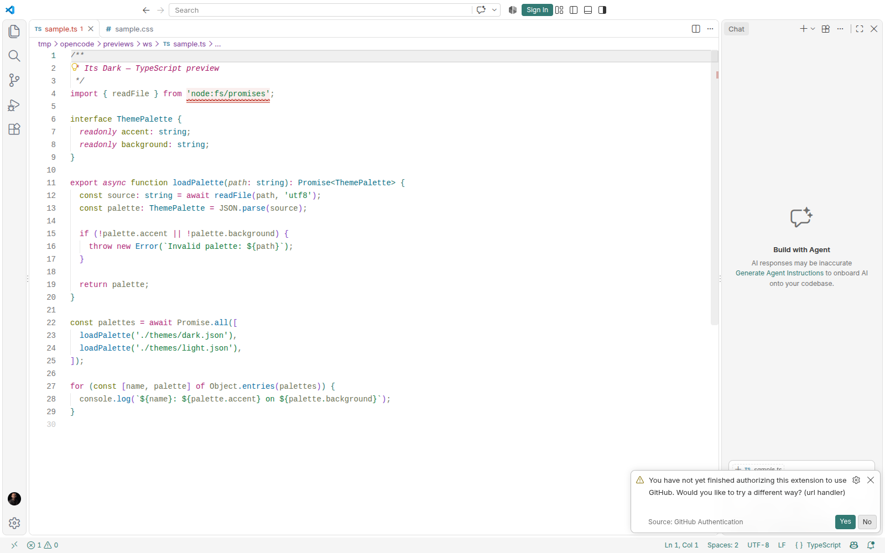
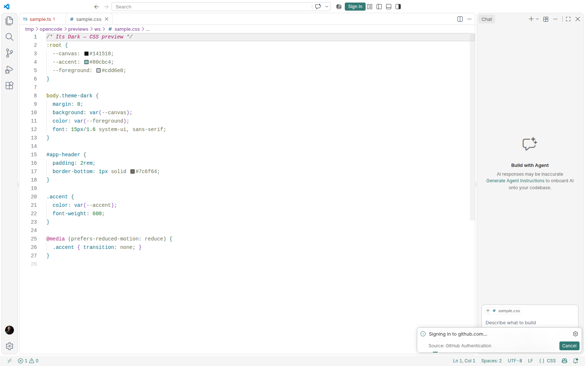

<p align="center">
  
</p>

<h1 align="center">Its Dark</h1>

<p align="center">
  <b>The original v9 palette, rebuilt for clarity — now with a matching light theme.</b>
</p>

<p align="center">
  A near-black canvas, teal-and-cyan accents, and a syntax spectrum where every token stays distinct.<br>
  Contrast-tuned for long sessions. Two themes, one design language.
</p>

<p align="center">
  <a href="https://marketplace.visualstudio.com/items?itemName=iamismiledev.its-dark"></a>
  <a href="https://marketplace.visualstudio.com/items?itemName=iamismiledev.its-dark"></a>
  <a href="https://marketplace.visualstudio.com/items?itemName=iamismiledev.its-dark"></a>
</p>

<p align="center">
  <a href="https://marketplace.visualstudio.com/items?itemName=iamismiledev.its-dark"><b>Install from the Marketplace &rarr;</b></a>
  &nbsp;·&nbsp; <a href="#installation">Other install options</a>
  &nbsp;·&nbsp; <a href="./CHANGELOG.md">What's new</a>
</p>

<p align="center">
  
</p>

---

## Why Its Dark

- **The palette you already loved, refined.** The original v9 canvas, teal `#80cbc4` and cyan `#00ffff` accents, yellow activity bar, and purple breadcrumb are restored from the tagged v9.0.0 tokens — with the invisible indicators, collapsed terminal colors, and weak contrast fixed.
- **Syntax you can scan at a glance.** Strings, types, functions, keywords, tags, and comments each keep their own v9 hue instead of collapsing into one accent color. Coverage spans TypeScript, JavaScript, HTML, CSS, Python, Java, C#, Markdown, JSON, YAML, Diff, Git, and INI.
- **A true light counterpart.** **Its Light** is derived from the same accent, semantic, and syntax roles — not a separate palette — so switching themes keeps your muscle memory intact.
- **Readability you can verify.** See the measured contrast ratios below rather than taking a marketing claim at face value.
- **Polish where it counts.** A visible active activity-bar marker, clear focus rings, readable ANSI terminal colors, and 271 color keys across both themes.

## Contrast

Ratios below are WCAG contrast measured against each theme's editor background; the activity marker is measured against the activity-bar background.

| Role | Its Dark | Its Light |
| --- | --- | --- |
| Editor text on canvas | 5.97:1 | 12.63:1 |
| Comments | 4.44:1 | 6.11:1 |
| Line numbers | 4.44:1 | 4.54:1 |
| Active activity-bar marker | 9.79:1 | 4.62:1 |
| Syntax tokens (range) | 5.1–16.4:1 | 5.0–7.1:1 |

---

## Preview

### Its Dark

<p align="center">
  
</p>

<p align="center">
  
</p>

### Its Light

<p align="center">
  
</p>

<p align="center">
  
</p>

---

## Installation

### Marketplace (recommended)

1. Open **VS Code** (1.62.0 or newer).
2. Go to the **Extensions** view (`Ctrl+Shift+X` / `Cmd+Shift+X`).
3. Search for **Its Dark** and click **Install**.
4. Open the Command Palette (`Ctrl+Shift+P` / `Cmd+Shift+P`) and run **Color Theme: Its Dark** or **Color Theme: Its Light**.

### From VSIX

1. Download the latest `.vsix` from the [Releases](../../releases) page.
2. Run **Extensions: Install from VSIX** in the Command Palette.
3. Select the file, then choose the theme from the Color Theme picker.

---

## Customization

Both themes are fully overridable in `settings.json`. For example, to warm up the dark canvas and soften selection:

```json
"workbench.colorCustomizations": {
  "[Its Dark]": {
    "editor.background": "#0f111a",
    "editor.selectionBackground": "#2c4a6e80",
    "editorLineNumber.foreground": "#8a94a6"
  },
  "[Its Light]": {
    "editor.background": "#fbfbfb"
  }
}
```

Token colors can be adjusted separately with `editor.tokenColorCustomizations` using the same `[Its Dark]` / `[Its Light]` theme selectors.

---

## FAQ

**The colors didn't change — what should I check?**
Make sure you selected the theme from the Color Theme picker rather than just installing it. Another extension or a `workbench.colorCustomizations` rule can also override these values.

**Does semantic highlighting work?**
Yes. The theme defines TextMate token rules; VS Code's semantic tokens are layered on top when your language server provides them and `editor.semanticHighlighting.enabled` is on.

**Which VS Code versions are supported?**
VS Code 1.62.0 or newer.

**Where do I report a problem or request a color?**
Open an issue on [GitHub](https://github.com/iamismile/its-dark/issues).

---

## License

This project is licensed under the [MIT License](./LICENSE).

## Support

If you enjoy **Its Dark**, a ⭐ on the [Marketplace](https://marketplace.visualstudio.com/items?itemName=iamismiledev.its-dark) or [GitHub](https://github.com/iamismile/its-dark) helps a lot. Feedback and suggestions are welcome via [GitHub Issues](https://github.com/iamismile/its-dark/issues).

---

<p align="center">
  Made with ❤️ by <a href="https://github.com/iamismile">iamismile</a>
</p>
