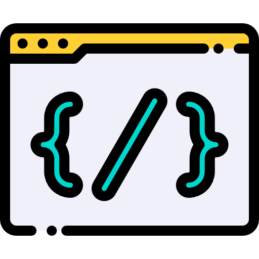
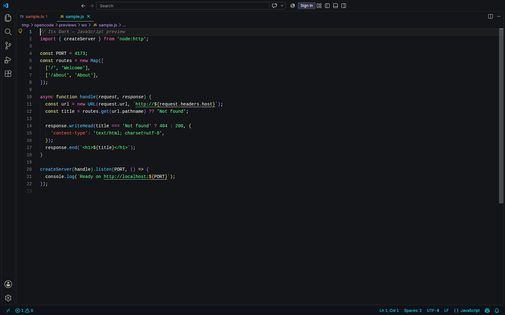
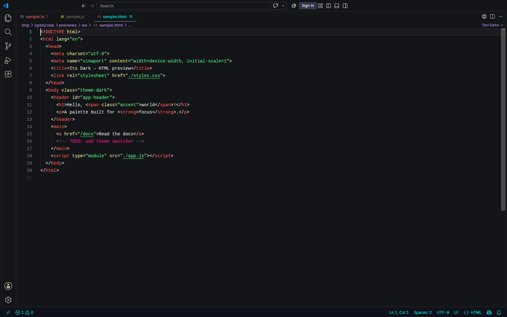

<p align="center">
  
</p>

<h1 align="center">Its Dark</h1>

<p align="center">
  <b>A refined, professional dark theme for Visual Studio Code.</b>
</p>

<p align="center">
  A balanced dark palette with intentional accent colors — built for clarity, focus, and polished presentation.
</p>

<div align="center" style="margin: 2rem 0;">
  <a href="https://marketplace.visualstudio.com/items?itemName=iamismiledev.its-dark">
    
  </a>
  <a href="https://marketplace.visualstudio.com/items?itemName=iamismiledev.its-dark">
    
  </a>
  <a href="https://marketplace.visualstudio.com/items?itemName=iamismiledev.its-dark">
    
  </a>
</div>

<p align="center" style="margin-top:2rem;">
  
</p>

---

## Overview

**Its Dark** is a handcrafted professional dark theme designed for modern development. Rather than competing neon accents, it uses a balanced dark palette with carefully selected highlight colors — reducing visual noise so you can stay focused on your code.

Prefer a lighter workspace? **Its Light** is also available — the same thoughtful design language in a clean, bright variant.

Whether you're writing TypeScript, reviewing pull requests, or presenting in a demo, Its Dark keeps your editor looking clean, consistent, and production-ready.

---

## Features

<table>
  <tr>
    <td><b>Cohesive dark palette</b></td>
    <td>A sophisticated foundation with carefully balanced contrast for long coding sessions.</td>
  </tr>
  <tr>
    <td><b>Intentional accent colors</b></td>
    <td>Signature highlights that guide the eye without overwhelming the interface.</td>
  </tr>
  <tr>
    <td><b>Optimized for readability</b></td>
    <td>Soft foreground tones, muted comments, and distinct syntax groups across languages.</td>
  </tr>
  <tr>
    <td><b>Polished UI throughout</b></td>
    <td>Refined activity bar, sidebar, tabs, status bar, terminal, and more.</td>
  </tr>
  <tr>
    <td><b>Broad language support</b></td>
    <td>Thoughtful token colors for TypeScript, JavaScript, HTML, CSS, Python, Java, C#, Markdown, JSON, YAML, and more.</td>
  </tr>
</table>

---

## Preview

<p align="center">
  
  
</p>

<p align="center">
  
  
</p>

---

## Installation

### Visual Studio Code Marketplace

1. Open **VS Code**.
2. Go to the **Extensions** view (`Ctrl+Shift+X` / `Cmd+Shift+X`).
3. Search for **Its Dark**.
4. Click **Install**.
5. Open the Command Palette (`Ctrl+Shift+P` / `Cmd+Shift+P`) and run **Color Theme: Its Dark**.

### From VSIX

1. Download the latest `.vsix` from the [Releases](../../releases) page.
2. Run **Extensions: Install from VSIX** in the Command Palette.
3. Select the downloaded file and activate the theme.

---

## Customization

Override any color in your `settings.json`:

```json
"workbench.colorCustomizations": {
  "[Its Dark]": {
    "editor.background": "#141518",
    "editor.foreground": "#8f93a2"
  }
}
```

---

## Supported Languages

TypeScript, JavaScript, HTML, CSS, Python, Java, C#, Markdown, JSON, YAML, Diff, Git, INI, and more.

---

## License

This project is licensed under the [MIT License](./LICENSE).

---

## Support

If you enjoy **Its Dark**, please consider leaving a ⭐ on the [Marketplace](https://marketplace.visualstudio.com/items?itemName=iamismiledev.its-dark) or [GitHub](https://github.com/iamismile/its-dark). Feedback and suggestions are welcome via [GitHub Issues](https://github.com/iamismile/its-dark/issues).

---

<p align="center">
  Made with ❤️ by <a href="https://github.com/iamismile">iamismile</a>
</p>
